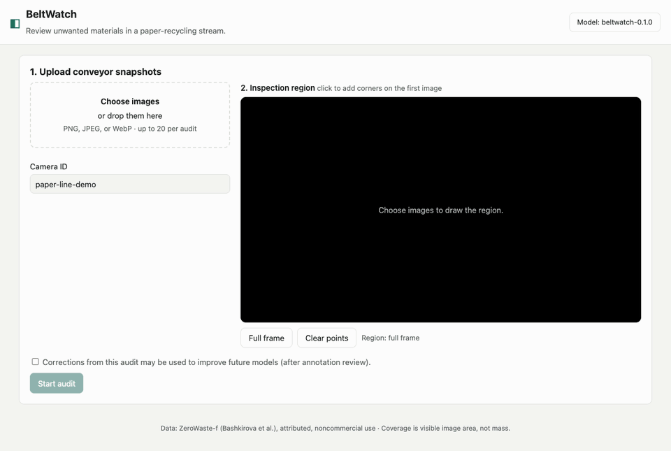
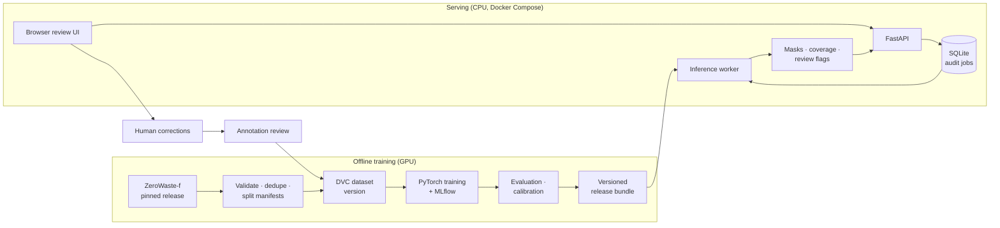
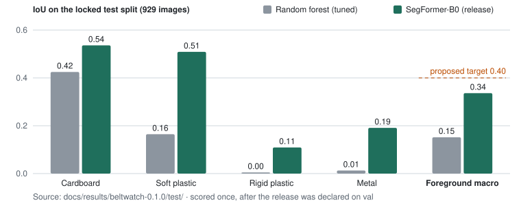

<div align="center">

# BeltWatch

**Visual contamination auditing for paper-recycling conveyor lines**

Semantic segmentation · visible-coverage estimation · uncertainty-aware review queue · auditable human feedback

[](https://github.com/professor3333/beltwatch/actions/workflows/ci.yml)
[](https://github.com/professor3333/beltwatch/actions/workflows/container.yml)
[](https://github.com/professor3333/beltwatch/actions/workflows/release.yml)
[](LICENSE)
[](https://ai.bu.edu/zerowaste/)


</div>

BeltWatch segments **cardboard, soft plastic, rigid plastic and metal** in
conveyor images from a paper-recycling stream, estimates how much of an
operator-drawn inspection region each material visibly covers, and ranks
images for a human reviewer, whose decisions are kept as an append-only audit
record.

> [!NOTE]
> **Status: first release evaluated.** `beltwatch-0.1.0` (SegFormer-B0) was
> declared on val and scored once on the locked test split: foreground macro
> IoU **0.336**, +18.4 points over the tuned random forest. It **misses** the
> proposed 0.40 target and the review-workload target. Pipeline, audit service
> and deployment are built and tested (357 tests).

<p align="center">
  
</p>
<p align="center"><sub>
  The review UI running the real <code>beltwatch-0.1.0</code> release. The images are
  procedurally generated because ZeroWaste-f frames are not redistributed here. On them the
  model finds the cardboard but misses the film, bottle and can, and the reviewer records the
  correction. The clip shows the workflow, not accuracy (see <a href="#results">Results</a>).
</sub></p>

## Architecture



## How it works

Waste on the belt arrives crushed, overlapping and sometimes translucent, so a
plastic bag can almost vanish against paper. For each uploaded image,
BeltWatch answers **what** material may be present, **where**, **how much** of
the region it covers, and **whether a person should look**.

- **Estimated visible coverage** of material *c* = pixels predicted as *c*
  inside the inspection region ÷ valid pixels in that region. It is **not**
  contamination by weight or bale purity, and "background" means "outside the
  four target labels", not certified clean paper.
- **Review policy** ([`configs/review_policy.yaml`](configs/review_policy.yaml)):
  images are prioritised by coverage, a share is reserved for uncertain
  predictions, and a random sample of low-risk images is always included to
  catch misses. Unusable images go to `retake_image`, uncertain ones to
  `manual_review`.
- **Audit trail:** every result records the model release, preprocessing and
  policy versions. Reviewer decisions are append-only, and corrections reach
  training data only with consent and after annotation review.

Models compared under matched data and preprocessing: all-background (sanity
check), a random forest on colour and texture features, U-Net (ResNet-18) and
SegFormer-B0. The primary metric is **foreground macro IoU** over the four
materials, with 95% paired-bootstrap intervals over recording groups
([evaluation protocol](docs/evaluation.md)).

## Results

`beltwatch-0.1.0` (SegFormer-B0, temperature 1.04) was selected on val and
scored **once** on the locked test split (929 images). The official splits
share recordings, so these numbers hold for **held-out time windows of the
same recordings**, not new recordings or facilities. Raw records:
[`docs/results/beltwatch-0.1.0/`](docs/results/beltwatch-0.1.0/README.md);
full tables: [model card](docs/model_card.md#evaluation).

<p align="center">
  
</p>

| Model (test) | Foreground macro IoU (95% CI) | Coverage MAE (bias), pp |
|---|---|---|
| All-background | 0.000 | 17.97 (−17.97) |
| Random forest (tuned on val) | 0.152 (0.125–0.161) | 16.81 (+16.43) |
| **SegFormer-B0 (release)** | **0.336** (0.285–0.368) | **4.98** (−0.65) |

| Proposed target | Result |
|---|---|
| ≥ 5 points over the tuned random forest | **Met:** +18.4 (CI +15.8 to +20.7) |
| Foreground macro IoU ≥ 0.40 | **Missed:** 0.336 |
| Coverage MAE ≤ 5 points | **Met, narrowly:** 4.98 (one val seed scored 5.38) |
| Recall vs workload clearly better than random | **Missed:** not demonstrable at 89.7% audit-positive prevalence |
| Seed spread ≤ 2 points | **Met:** 0.29 points over 3 seeds (val) |
| p95 ≤ 3 s, ≥ 0.5 images/s, ≤ 2 GB (4 vCPU / 8 GB) | **Met:** p95 ≤ 0.79 s, ≥ 1.32 images/s, ≤ 1.07 GB ([3 runner runs](docs/results/beltwatch-0.1.0/host-benchmark/)) |
| ≥ 99% of 200 jobs succeed, no duplicate completions | **Met:** 200/200 with 13 worker kills ([soak test](docs/operations.md#reliability-soak-test), local Mac) |

- **Weak classes:** the release finds 73% of cardboard and 60% of soft-plastic
  pixels but only 13% of rigid plastic (mostly confused with soft plastic) and
  28% of metal (mostly missed as background).
- **Unseen recording** (sequence 08, 215 images): 0.321; rigid plastic drops to 0.038.
- **Calibration** (T 1.04): test ECE 0.019 → 0.015; foreground ECE 0.242 →
  0.234 remains poor.
- **Review routing (val):** review-policy-1 sends 91.6% of images to a person
  and catches 96.7% of audit-positive ones; a declared threshold grid found
  nothing better ([details](docs/evaluation.md#review-policy-evaluation)).

## Quickstart

Requires Python 3.12 and [uv](https://docs.astral.sh/uv/). Tests need no
network or dataset.

```bash
uv sync --extra cpu           # locked deps + CPU PyTorch (GPU machine: --extra cu126)
uv run pytest -m "not slow"   # tests
uv run ruff check && uv run ruff format --check && uv run mypy
```

Run the audit service locally with the all-background sanity-check release
(trained weights are not in the repository):

```bash
uv run python -m beltwatch.release.bundle --kind all-background --version demo \
    --note "service check; not a trained model" --activate
uv run uvicorn beltwatch.api.app:create_app --factory --port 8000   # terminal 1
uv run python -m beltwatch.jobs.worker                              # terminal 2
```

Open `http://localhost:8000/` for the review UI or `/docs` for the API. Deploy
with Docker Compose (HTTPS proxy, API, worker):

```bash
docker compose build
docker compose run --rm --no-deps --user root api \
    python -m beltwatch.release.activate <version> --reason "initial" --releases-dir /releases
docker compose up -d --wait
python3 scripts/deploy_smoke.py --base-url https://localhost --insecure --expect-version <version>
```

Rollback re-activates the complete previous bundle and is exercised in CI
([operations.md](docs/operations.md#roll-back)). Data download, baselines,
training, calibration, benchmarks, feedback export and the usability study:
**[docs/usage.md](docs/usage.md)**.

## Data

[ZeroWaste-f](https://ai.bu.edu/zerowaste/) (Boston University and
collaborators; [paper](https://proceedings.mlr.press/v220/bashkirova23a/bashkirova23a.pdf)),
pinned to [Zenodo record 6412647](https://zenodo.org/records/6412647)
(`zerowaste-f-final.zip`, about 7.5 GB, MD5-verified). Measured: 4,503 valid
1920 × 1080 images. After the
[official-repaired split policy](docs/dataset_card.md#split-policy-official-repaired):
train 2,888 · val 370 · calibration 200 · test 929 (locked) · excluded 116,
split manifest `c8285117…` in `data/splits/`.

> [!IMPORTANT]
> **License discrepancy.** Zenodo shows CC BY 4.0; the project website and
> [repository](https://github.com/dbash/zerowaste) state CC BY-NC 4.0.
> BeltWatch treats the data as **attributed and noncommercial** and never
> redistributes it ([THIRD_PARTY_NOTICES.md](THIRD_PARTY_NOTICES.md)).

**Committed:** code, configs, split manifests, DVC lock, release declarations
and evaluation records. **Not committed:** images, checkpoints, MLflow stores,
uploads, credentials.

## Limitations

- Frames come from related video and the official splits share recordings;
  leakage is reduced (buffers, duplicate removal, an unseen-recording slice)
  but independence is not guaranteed ([details](docs/dataset_card.md#splits-and-leakage-findings)).
- One facility and a narrow range of conditions; no claim about other
  facilities or cameras without local validation.
- Four target materials only; rigid plastic (0.109) and metal (0.191) are weak.
- The test split has been read; further tuning needs a new untouched evaluation set.
- Not yet done: usability sessions with participants
  ([protocol ready](docs/usability_study.md)), a staged robustness set, and a
  published hosted demo.

## Tech stack and layout

| Area | Tools |
|---|---|
| Modeling | PyTorch, Hugging Face Transformers, scikit-learn, scikit-image |
| Data and experiments | DVC, MLflow, Pillow/OpenCV, NumPy |
| Serving | FastAPI, Pydantic, SQLite, plain HTML/JS frontend |
| Operations | Docker Compose, Caddy, Prometheus, GitHub Actions |

```
src/beltwatch/   data · baselines · models · training · evaluation · inference (shared preprocessing)
                 api · jobs · review · release · study · demo
configs/         dataset pin, model and review-policy configs, release declarations
frontend/        review UI and usability-study page (static HTML/CSS/JS)
scripts/         train, evaluate, compare, error report, benchmark, deploy smoke, soak test
docs/            design, dataset/model cards, evaluation, training, architecture, operations, results
data/            git-tracked manifests and splits (the data itself via DVC)
```

| Document | Contents |
|---|---|
| [design.md](docs/design.md) | Full plan, targets and Definition of Done |
| [model_card.md](docs/model_card.md) · [dataset_card.md](docs/dataset_card.md) | Intended use, results, failure modes · provenance, splits, leakage |
| [evaluation.md](docs/evaluation.md) · [error_analysis.md](docs/error_analysis.md) | Metric protocol · findings log |
| [architecture.md](docs/architecture.md) · [operations.md](docs/operations.md) | Service design · deploy, rollback, monitoring |
| [training.md](docs/training.md) · [usage.md](docs/usage.md) | GPU runbook · command reference |

## License

Code: [MIT](LICENSE). The ZeroWaste-f dataset and the pretrained SegFormer
weights have their own, more restrictive terms
([THIRD_PARTY_NOTICES.md](THIRD_PARTY_NOTICES.md)). Built on the ZeroWaste
dataset by Dina Bashkirova et al. and SegFormer by NVIDIA Research.
